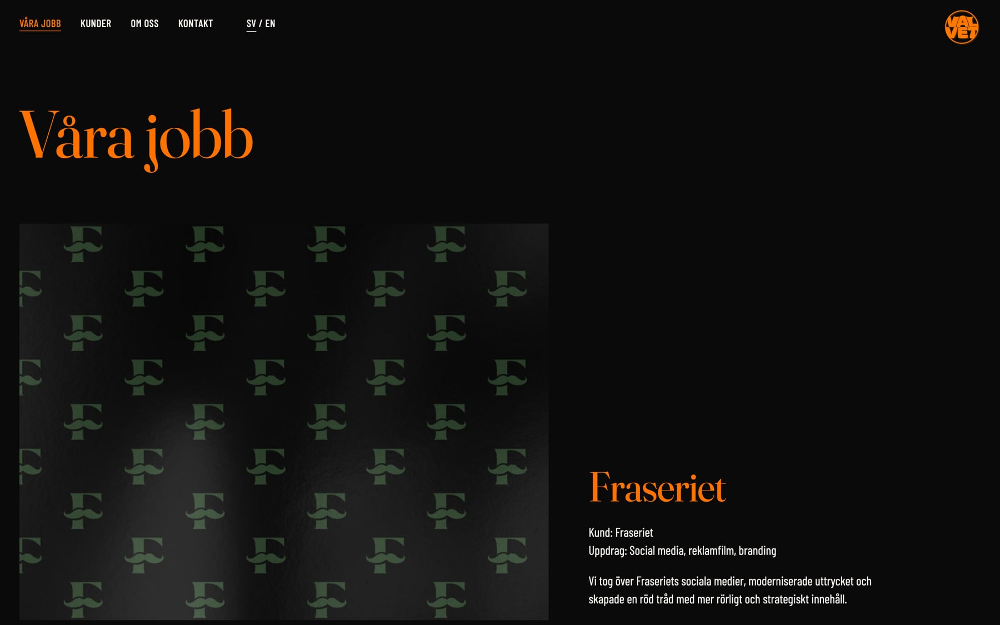
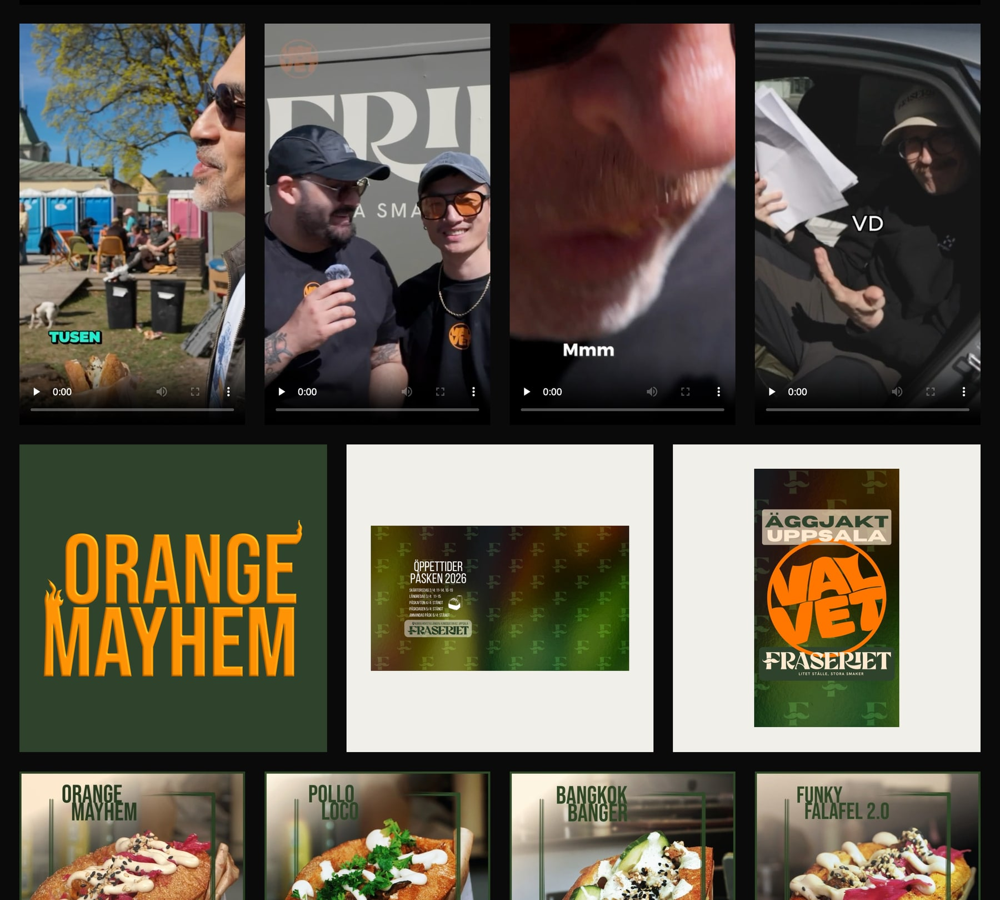
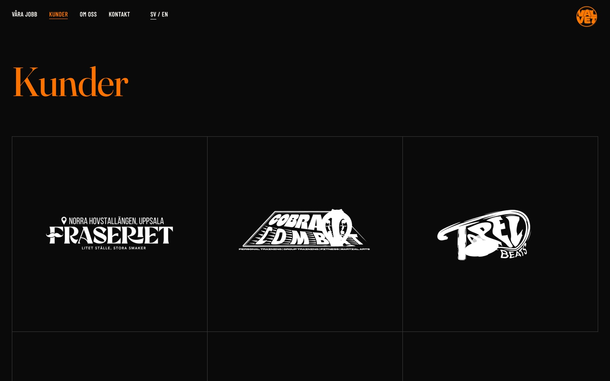
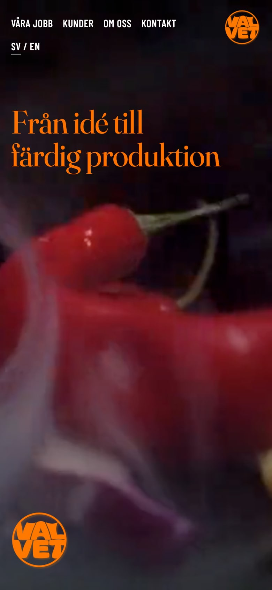
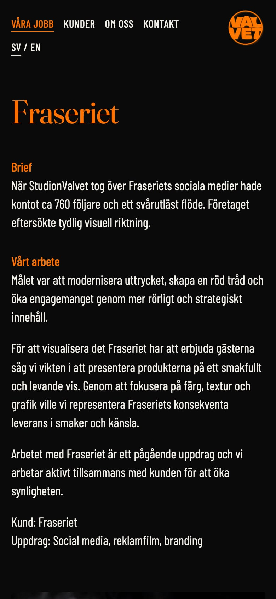
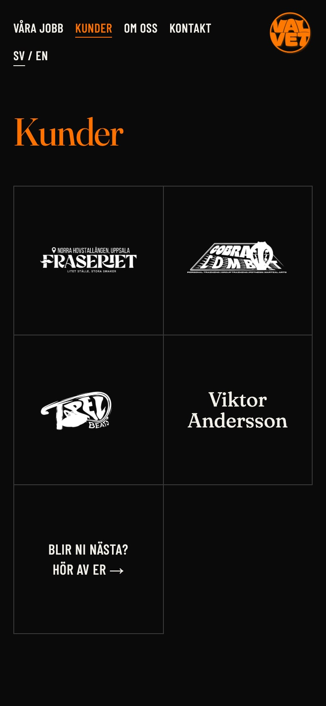

## Om StudionValvet

StudionValvet är en kreativ studio i Gamla Riksbankshuset i centrala Uppsala. De gör film, content, design och musik åt varumärken, artister och företag, från idé till färdig produktion.

## Utmaningen

StudionValvet ville ha en uppdaterad hemsida. För en studio som lever på bild och film är det själva jobben som säljer, så målet var en sida där arbetet får ta plats. De ville också kunna uppdatera den själva när nya jobb blir klara, utan att höra av sig till mig varje gång.

## Vad jag gjorde

**Jobben först.** Startsidan öppnar med en film och följs av studions jobb i helskärm. Skrollar man nära nästa jobb glider sidan dit av sig själv, så varje jobb visas för sig. Startfilmen klippte jag om ur originalet i högre kvalitet.

**En sida per jobb.** Varje uppdrag har en egen sida med uppdraget, vad studion gjorde och ett rutnät med filmer och bilder. Filmerna spelas direkt på sidan.

**Svart och orange.** Färgerna bestämde vi tillsammans med studion: svart bakgrund, orange accent och ett elegant typsnitt till rubrikerna. Det matchar deras logga och låter bilderna synas.

**Svenska och engelska.** Sidan finns på båda språken, med svenska som standard. Varje sida har en egen adress per språk, så att båda kan hittas på Google.

**En egen admin.** Studion loggar in på en adminsida och ändrar rubriker, texter, jobb, kunder, bilder och startfilmen själv, på båda språken. Bilder visas direkt i admin och görs om till rätt format och storlek när de laddas upp. När de sparar byggs sidan om automatiskt och är uppdaterad efter någon minut.

## Hur det är byggt

Sidan består av vanliga, statiska HTML-sidor utan tunga ramverk, så den laddar snabbt och kostar ingenting att ha på nätet. Innehållet ligger som textfiler, och ett litet byggskript gör om dem till färdiga sidor på båda språken varje gång något ändras i admin. Adminsidan är Sveltia CMS, ett gratis publiceringsverktyg med öppen källkod. Det innebär att studion inte är bunden till något abonnemang för att kunna redigera sin egen sida.

## Resultatet

StudionValvet har en hemsida som visar vad de faktiskt gör, och de kan själva lägga upp nya jobb när de blir klara.
